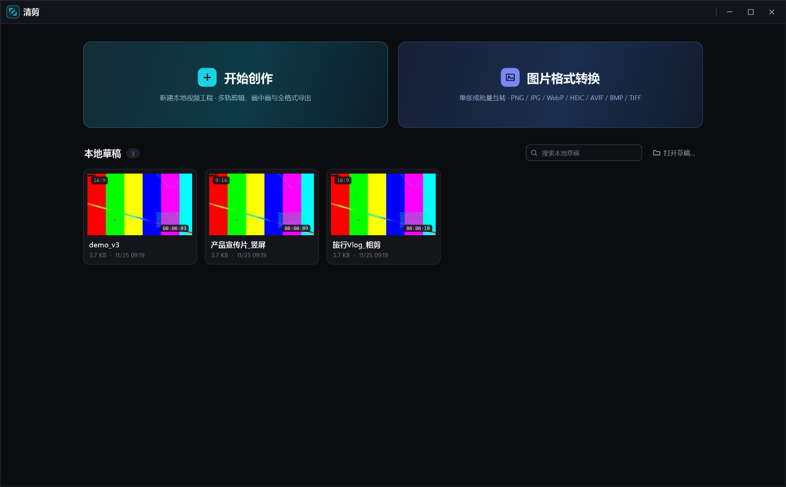
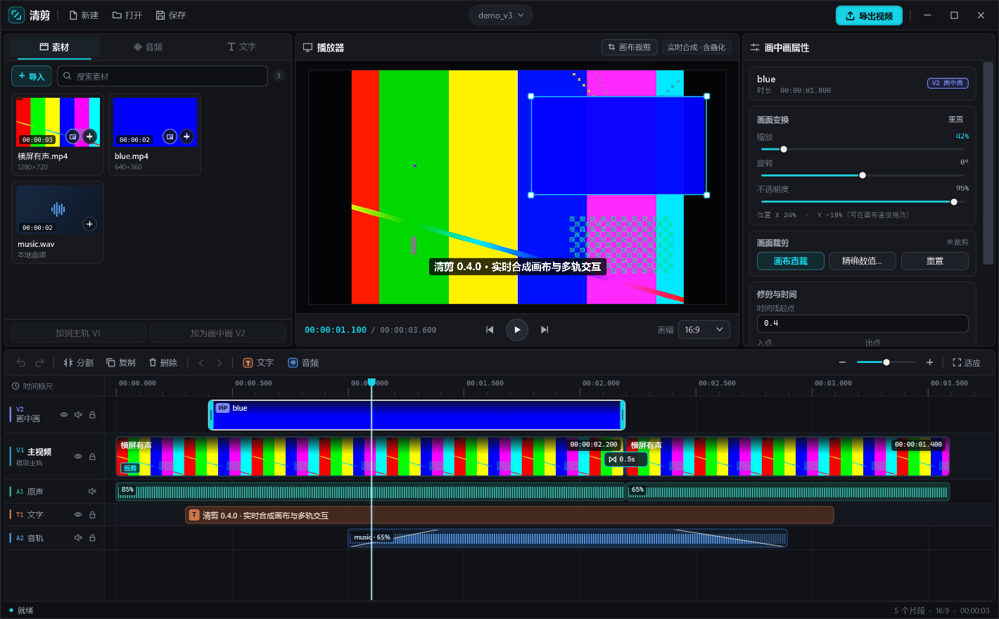
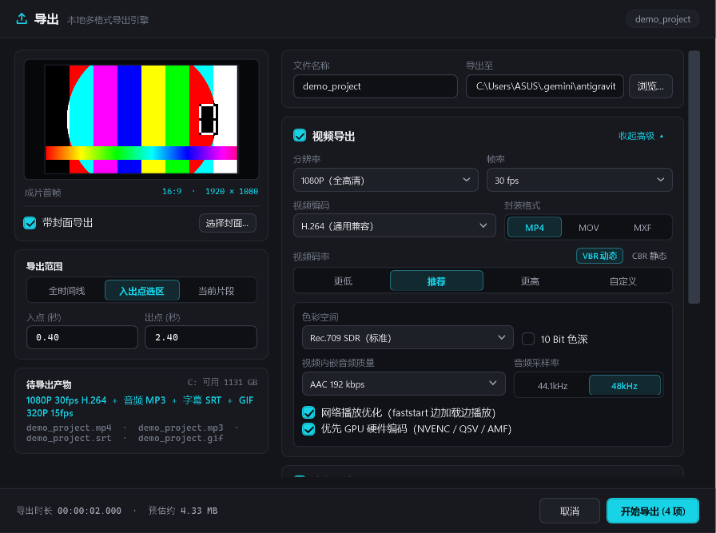
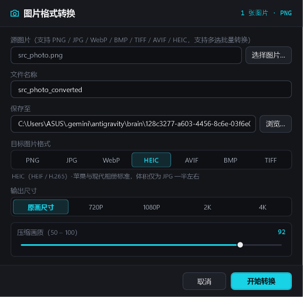

# 清剪（Qingjian）

> 极简、无广告、无会员、纯本地的 Windows 视频剪辑与图片格式转换工具。

清剪基于 **.NET 8 + WPF + FFmpeg** 构建，采用面向精准审片的 **Obsidian Studio** 中性暗黑视觉体系。所有素材与工程文件均留在本地硬盘，无账号登录、无云空间诱导、无广告弹窗、无水印限制。



---

## 核心特性

### 1. 极简启动首页
- **双主入口**：左侧 **「开始创作」** 一键新建本地视频项目，右侧 **「图片格式转换」** 无需进入剪辑台即可单张/批量互转图片格式。
- **本地草稿管理**：自动记录最近打开与保存的 `.qingjian` 工程，展示封面缩略图、画幅、时长与修改时间，支持搜索、右键定位文件与直接拖入打开。

### 2. 实时多层合成画布与 5 轨磁吸时间线


- **实时合成画布**：支持 `V1` 主视频、`V2` 画中画与 `T1` 样式化文字实时叠加预览；画布内支持鼠标直拖移动、四角等比缩放、居中青色磁吸辅助线，以及四边交互式**画布直裁**。
- **5 轨时间线**：`V2 画中画` / `V1 磁吸主轨` / `A1 原声` / `T1 文字` / `A2 独立音轨`，配备轨头隐藏/静音/锁定开关、真实音频波形（含淡入淡出斜坡可视化）、边缘拖拽修剪、`±8px` 磁吸对齐与全轨右键菜单。
- **本地全媒体导入**：支持视频、音频与本地图片（`PNG / JPG / WebP / HEIC / AVIF / BMP / TIFF`），素材库右键支持入轨、替换素材、打开文件所在位置、查看素材信息、移除与一键清理未使用素材。
- **右侧多态检视器**：单击任意轨道片段原地切换属性面板（变换/裁剪/叠化/音轨分离/文字排版预设/音量淡入淡出）。
- **明文工程格式（`.qingjian` v3）**：开放 JSON 格式存储，向下兼容 v1/v2，原素材保留在原路径不重复拷贝。

### 3. 全能本地导出中心（Export Studio）


- **4 大可独立勾选产物（支持一次同时导出）**：
  - **视频导出**：`480P / 720P / 1080P / 2K / 4K / 8K`、`24–60 fps`（含 `29.97 / 59.94`）；10 种编码（`H.264`、`HEVC`、`HEVC 4:2:2 10-bit`、`AV1`、`Apple ProRes Proxy/LT/422/422 HQ/4444`、`QuickTime RLE`）；`MP4 / MOV / MXF` 封装；`VBR / CBR` 码控与自定义码率；`Rec.709 / Rec.2020 / Rec.2100 HLG / PQ` 色彩空间与 10-bit；内嵌 `AAC / PCM 无损` 与 `faststart` 网络播放优化；自动探测 `NVENC / QSV / AMF` 硬件编码并支持软编回退。
  - **独立纯音频**：`MP3 / WAV / AAC (.m4a) / FLAC / AIFF / OGG`（`192/256/320 kbps`、`44.1 / 48 kHz`）。
  - **独立字幕**：`SRT` 标准时间轴与 `TXT` 纯文本。
  - **GIF 动图**：`240P / 320P / 480P / 640P`，`10 / 15 / 20 fps`，调色板两步高画质生成。
- **封面、范围与静帧**：支持自定义封面嵌入 MP4/MOV、全时间线 / 入出点选区 / 当前选中片段导出、磁盘剩余空间与 FAT32 检测，以及播放器一键「导出静帧画面」。

### 4. 内置 7 格式图片转换器


- 支持将 `PNG / JPG / WebP / HEIC / AVIF / BMP / TIFF` 单张或批量互转，可调节输出尺寸（原画 / 720P / 1080P / 2K / 4K）、压缩画质（50–100）与 WebP 无损模式。
- 内置纯 C# **ISO/IEC 23008-12 HEIC 封装器**，无需安装系统扩展即可将任意图片或视频静帧输出为标准 `.heic` 文件。

---

## 快捷键

| 操作 | 按键 |
| :--- | :--- |
| 导入本地素材 | `Ctrl + I` |
| 新建 / 打开 / 保存项目 | `Ctrl + N` / `Ctrl + O` / `Ctrl + S` |
| 播放 / 暂停 | `Space` |
| 跳到起点 / 结尾 | `Home` / `End` |
| 在播放头分割 | `Ctrl + B` |
| 复制选中片段 | `Ctrl + D` |
| 删除选中片段 / 素材 | `Delete` |
| 撤销 / 重做 | `Ctrl + Z` / `Ctrl + Y` |
| 缩放时间线 | `Ctrl + 滚轮` |

---

## 运行环境与构建

### 运行预编译版本（开箱即用，无前置依赖）
1. 从 [Releases](../../releases) 下载最新 `Qingjian-0.4.0-Windows-x64.zip`，解压后直接双击 `Qingjian\Qingjian.exe` 即可启动。
2. 仅需 **Windows 10 / 11 (x64)** —— 压缩包已完整内置：
   - **自包含单文件 `Qingjian.exe`**（内嵌 .NET 8 Desktop Runtime，无需额外安装 .NET 运行时）
   - **`ffmpeg/ffmpeg.exe` 与 `ffmpeg/ffprobe.exe`**（FFmpeg 9.0.2 Full Build，内置全部编解码器，无需配置 `PATH`）

### 从源码构建
需要 **.NET 8 SDK**，运行时需确保系统 `PATH`、程序目录或 `ffmpeg/` 子目录中有 `ffmpeg.exe` 与 `ffprobe.exe`：

```powershell
# 常规开发构建
dotnet build src/Qingjian/Qingjian.csproj -c Release

# 发布自包含单文件（win-x64）
dotnet publish src/Qingjian/Qingjian.csproj -c Release -r win-x64 --self-contained true `
  -p:PublishSingleFile=true -p:IncludeNativeLibrariesForSelfExtract=true `
  -p:EnableCompressionInSingleFile=true -o dist/Qingjian
```

---

## 开源协议

本项目源码基于 [MIT License](LICENSE) 开源。独立便携版内置的第三方预编译 FFmpeg 二进制文件遵循其随附许可声明（`ffmpeg/LICENSE-FFmpeg.txt`）。
